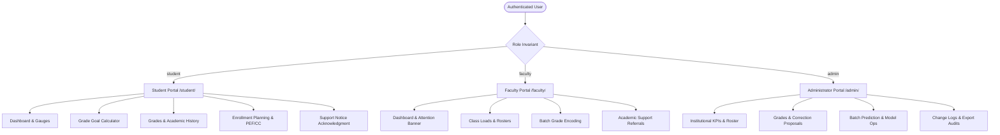

# System Context and Current State — UDM-RADAR

**Document Version:** 1.0.0 (Post-Defense Baseline)
**Accepted `origin/main` Baseline:** `a79fb4838c5e2bc163cf943cda20afba9946d26b`
**Audience:** Proponents, Faculty Panel, Team Members, and Autonomous Coding Agents
**Maintainer:** Proponents / Sol / Antigravity

---

## 1. What UDM-RADAR Is

**Universidad de Manila — Risk Analytics & Decision-support for Academic Records (UDM-RADAR)** is a web-based, role-governed academic decision-support prototype developed for the College of Computing Studies (CCS).

### Core Purpose:
- Early identification of academic risk among undergraduate students (focusing on Third-Year Bachelor of Science in Information Technology students).
- Continuous projection of General Weighted Average (GWA) using human-in-the-loop machine learning and transparent calculation-based fallbacks.
- Non-punitive academic support workflows connecting Students, Faculty, and Administrators.
- Registrar-aligned curriculum pacing, grade-goal feasibility planning, and audit-logged administrative grade corrections.

### Strict Non-Punitive Prototype Boundary:
> [!IMPORTANT]
> **Advisory Nature:** UDM-RADAR provides non-punitive decision support. Predictions, projected GWAs, and risk classifications do not constitute official registrar evaluations, binding academic standing determinations, warning status, academic probation, dismissal countdowns, scholarship disqualifications, or disciplinary actions. All user-facing views carry the mandatory label: `Prototype performance on synthetic academic records`.

---

## 2. Core User Roles and Portal Architecture

The platform provides three authenticated, role-restricted portals:

1. **Student Portal (`student/`):**
   - Personal academic dashboard with historical cumulative GWA and current projected GWA.
   - Visual risk gauges (`LOW`, `MODERATE`, `HIGH`) with supportive, student-safe advisory copy.
   - Grade Goal Calculator with reachable point targets and feasibility constraints.
   - Term-by-term read-only grade history.
   - Academic Support Notice receipt acknowledgment.
   - Pre-Enrollment Form & Curriculum Checklist (PEF/CC) planning and PDF export.
   - Feedback ticket submission.

2. **Faculty Portal (`faculty/`):**
   - Section roster management by teaching load (`faculty_class_loads`).
   - Preliminary, midterm, and pre-final raw percentage grade encoding.
   - Batch grade submission workflow requiring Administrator approval.
   - Student academic support case referrals with structured reason codes (`support_case_referrals`).
   - Notice issuance with immutable timestamp tracking (`notice_issued_at`).

3. **Administrator Portal (`admin/`):**
   - Program-level and section-level academic risk analytics.
   - Approval of faculty grade batches (`pending_grade_batches`).
   - Student grade review modal with lazy-loaded read-only academic history.
   - Governed grade correction proposals (`pending_corrections`) and audit trail (`admin_change_log`).
   - Batch ML prediction execution and provenance monitoring.
   - Administrative CSV and PDF reporting with compliance audit logging (`export_audit_logs`).

---

## 3. Technology Stack & Operational Architecture

| Layer | Component | Version / Specification | Rationale & Invariants |
|---|---|---|---|
| **Web Server** | Apache (XAMPP) | 2.4.x / Port 80 | Serves the canonical checkout at `C:\xampp\htdocs\capstone`. |
| **Backend Runtime** | PHP | 8.2.x (64-bit) | Strict native types, PDO prepared statements (`EMULATE_PREPARES => false`), native password hashing. |
| **Database** | MariaDB | 10.4.x / Port 3306 | Character set `utf8mb4`, engine `InnoDB`. Exactly 18 base tables in baseline. |
| **Machine Learning Service** | Python Flask | 3.0.0 / Python 3.10+ | Serves Decision Tree regressor at `http://127.0.0.1:5000`. Non-blocking: application falls back to calculation if offline. |
| **ML Framework** | scikit-learn | 1.4.0 / joblib 1.3.2 | Regression Decision Tree trained on synthetic curriculum features. Model artifact: `python_ml/model.pkl`. |
| **PDF Generation** | Dompdf / COM Excel | Dompdf ^3.1 / Excel COM | Dompdf for standard portal reports; Excel COM for pixel-perfect PEF/CC legal folio exports (8pt floor). |
| **Spreadsheet Ingestion** | PhpSpreadsheet | 5.10.0 | Ingestion of official BSIT Curriculum Checklist structures. |
| **Frontend UI** | HTML5 / CSS3 / Vanilla JS | Zero bulky JS frameworks | Custom responsive tokens (`assets/css/`), Chart.js 4.x for accessible canvas data visualizations. |
| **Browser Testing** | Playwright | 1.63.0 / Node.js | Pinned end-to-end regression testing across viewports (360px mobile to 1440px desktop). |

---

## 4. Academic Grading Scale and Prototype Boundaries

UDM-RADAR strictly operates on the discrete point scale currently configured and accepted for the UDM-RADAR prototype and codified in `config/constants.php`:

### 4.1 Numerical Scale Direction (Higher Numbers Indicate Stronger Performance)
- **Range:** `4.00` (Highest/Excellent) down to `1.00` (Minimum Passing Grade) and `0.00` (Numeric Failure).
  - `4.00`: $99\text{--}100\%$
  - `3.00`: $93\text{--}95\%$
  - `2.00`: $84\text{--}86\%$
  - `1.00`: $75\%$ (Minimum Passing Point Grade)
  - `0.00`: $74\%$ and below (Numeric Failure)
- **Term Weighting Formula:**
  $$\text{Final Percentage} = (\text{Prelim} \times 0.30) + (\text{Midterm} \times 0.30) + (\text{Pre-Final} \times 0.40)$$
  - Raw preliminary, midterm, and pre-final inputs are raw percentages ($0\text{--}100\%$).
  - Final Grade is an official discrete point grade (`4.00` to `1.00`, `0.00`) or recognized textual outcome.

### 4.2 Prototype Risk Triage vs. Official Institutional Standing
> [!IMPORTANT]
> **Boundary Distinction:**
> Prototype risk-triage tiers (`HIGH`: GWA $<1.75$, `MODERATE`: GWA $1.75\text{--}2.49$, `LOW`: GWA $\ge 2.50$) are internal decision-support thresholds designed solely for early advising alerts. They do **not** constitute official institutional academic standing, warning status, probation, or dismissal, which remain under the exclusive jurisdiction of the College Dean and University Registrar.

### 4.3 Textual Outcomes & GWA Exclusions
- Stored as `VARCHAR(10)` in `grades.final_grade` protected by `chk_grades_final_grade_domain`.
- **Recognized Outcomes:**
  - `INC`: Incomplete. Unresolved, neither passing nor failed. Excluded from pass-rate denominators and numeric GWA.
  - `DRP`: Dropped.
  - `P`: Passed (textual outcome without numeric quality point).
  - `DO`: Dropped Official.
  - `DU`: Dropped Unofficial.
  - `FA`: Failure due to excessive absences.
  - `UD`: Unofficial Drop.
- **Unit-Weighted GWA Calculation:**
  $$\text{GWA} = \frac{\sum (\text{Numeric Point Grade} \times \text{Units})}{\sum \text{Units for Numeric Point Grades}}$$
  Non-numeric outcomes (`INC`, `DRP`, `P`) and legacy zeros are excluded from GWA unit denominators pending institutional confirmation.

### 4.4 Prototype-Configured Advisory Academic Risk Triage
- **Low Risk:** GWA $2.50$ and above.
- **Moderate Risk:** GWA $1.75$ through $2.49$.
- **High Risk:** GWA below $1.75$.

> [!CAUTION]
> **Term Separation:** Risk classification is strictly separate from official academic standing (`Regular` vs `Irregular`), subject failure, academic probation, or tuition retention qualifications.

---

## 5. Machine Learning, Evidence States, and Fallbacks

### 5.1 Model Provenance
Predictions stored in the `predictions` table carry mandatory `prediction_source` provenance (enforced by `chk_predictions_source_valid`):
1. `decision_tree`: Machine learning Decision Tree regressor projection.
2. `heuristic`: Preserved legacy 50/50 blend heuristic.
3. `calculation_fallback`: Deterministic calculation fallback derived from current grades.

### 5.2 Four-Tier Prediction Completeness Matrix (Migration 008)
Enforced by table-level CHECK constraints:
- `complete`: All enrolled subjects have contributing grades (`is_provisional = 0`, `provisional_basis = NULL`).
- `historical_only`: Historical completed GWA only; current preliminary grades unencoded (`is_provisional = 1`, `provisional_basis = 'historical_gwa'`).
- `prelim_only`: Current preliminary grades available without historical record (`is_provisional = 1`, `provisional_basis = 'current_prelim_avg'`).
- `legacy_unknown`: Pre-existing baseline rows without generation metadata.
- **Failsafe:** Missing all inputs produces ZERO prediction rows.

---

## 6. Functional Workflows Overview

1. **Grade Goal Calculator (UX-011):**
   - Enables students to calculate required Pre-Final percentage targets to attain a desired term point grade.
   - Unreachable point targets (where required Pre-Final score exceeds 100%) are mathematically disabled with accessible tooltips, preventing false optimism.

2. **Admin Grades Read-Only History Modal (PR #57):**
   - Opened from `admin/grades.php`.
   - Displays student academic context, stable `MODERATE` risk badges, and governed current-semester grade correction proposals.
   - Accordion control lazy-loads complete First Year through Third Year historical grades in read-only mode via shared helper `includes/grade_history.php`.

3. **Academic Support Intervention (FACULTY-WP1A):**
   - High-risk predictions generate parent support cases (`academic_support_cases`).
   - Faculty issue subject-level referrals (`support_case_referrals`) selecting one of six canonical reasons (`low_assessment_score`, `missing_course_requirement`, `performance_needs_review`, `incomplete_grade_data`, `consultation_recommended`, `other_academic_concern`).
   - Notice issuance captures immutable timestamp (`notice_issued_at`). Student acknowledgment records receipt timestamp only (never admission of fault).

4. **Pre-Enrollment Form & Curriculum Checklist (PEF/CC):**
   - Evaluates completed units against the BSIT 2022–2023 curriculum catalog (`config/bsit_software_development_curriculum_2022_2023.php`).
   - Supports four valid planning states: Normal (State A), Provisional Planning Copy (State B - red warning notice on incomplete current grades), Review-Required (State C), and Ineligible (State D).

---

## 7. Database Baseline and Boundary Isolation

- **Current Verified Application Base Tables:** Exactly 18 tables:
  `users`, `student_profiles`, `subjects`, `faculty_class_loads`, `grades`, `predictions`, `academic_support_cases`, `support_case_referrals`, `support_actions`, `support_status_history`, `feedback_reports`, `feedback_messages`, `feedback_status_history`, `pending_grade_batches`, `pending_corrections`, `admin_change_log`, `export_audit_logs`, `otp_tokens`.
- **Approved Migrations:** `000` through `010` in `database/migrations/`.
- **Migration 011 Status:** Migration 011 is excluded from the accepted migrations 000 to 010 baseline and remains unapproved.
- **Database Isolation Invariant:**
  - `udm_radar`: Production/dev database. Automated write scripts are strictly forbidden.
  - `udm_radar_scratch`: Automated mutation testbed.
  - `udm_radar_val_temp`: Temporary disposable database for onboarding verification.
- **Starter Synthetic Seed:** `database/seeds/001_synthetic_demo.sql` provides safe initial demo accounts with a built-in safety refusal gate that aborts with SQLSTATE 45000 if users already exist.

---

## 8. Current Known Limitations & Environment Quirks

1. **Local Python ML Service:**
   If `python app.py` is not running on port 5000, PHP gracefully switches to `calculation_fallback`. Batch predict cards display fallback notices rather than fatal errors.
2. **PEF/CC PDF Generation on Windows:**
   Requires local Windows Excel COM object and an installed PDF virtual printer driver. If Excel COM is unavailable, browser planning previews remain fully operational.
3. **Synthetic Section Calibration:**
   Grades and risk distributions across sections IT-31 through IT-38 were calibrated for software functionality testing and do not represent actual historical student performance in UDM sections.
4. **Active Checkout Stability:**
   The canonical Apache checkout lives at `C:\xampp\htdocs\capstone`. Team members and AI agents must work in dedicated registered worktrees and never edit the live checkout directly.

---

## 9. Post-Defense Analytics Roadmap & Metrics Governance

The post-defense revision scope encompasses **seven roadmap phases, consisting of Phase 0 through Phase 6**, governing 21 analytical metrics (`MTR-01` through `MTR-21`):
- **Phase 0:** Baseline & Continuity Package (`MVP COMPLETE, PR PENDING` on branch `docs/post-defense-continuity-package`).
- **Phases 1 through 6:** Analytics implementation, multidimensional filtering, and chart refinement, actively owned by Sol.
- **Timing Metrics Separation:** Operational responsiveness (`MTR-20: Mean Time to First Action`) and case resolution duration (`MTR-21: Mean Time to Intervention Closure`) are strictly separated into independent analytical metrics with distinct denominators and open-case exclusion rules.
