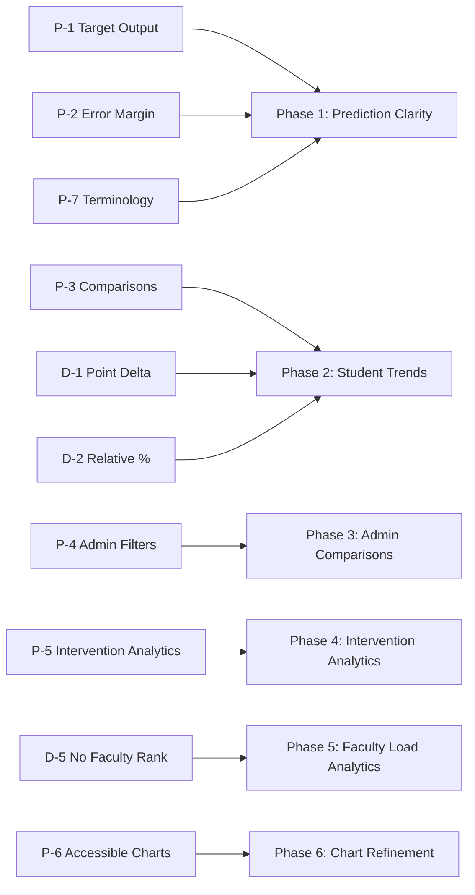

# Defense Feedback and Implementation Decisions — UDM-RADAR

**Document Version:** 1.0.0 (Post-Defense Baseline)
**Accepted `origin/main` Baseline:** `a79fb4838c5e2bc163cf943cda20afba9946d26b`
**Scope:** Formal separation of Capstone Defense Panel recommendations from Proponent architectural decisions.

---

> [!IMPORTANT]
> **Strict Attribution Rule:**
> Autonomous agents and contributing team members must strictly distinguish between **Panel-Requested Outcomes** (the academic problems identified by the panel) and **Proponent Implementation Decisions** (the technical solutions selected by the research proponents). Never cite a proponent implementation choice as a panel mandate.

---

## 1. Panel-Requested Outcomes

During the capstone oral defense and manuscript review, the academic panel raised specific observations regarding model transparency, comparative data utility, and analytical clarity.

| # | Panel Observation / Critique | Panel-Requested Outcome | Affected Portals |
|---|---|---|---|
| **P-1** | **Target Output Confusion:** Observers confused whether the Decision Tree predicts a discrete risk category (`HIGH`/`MODERATE`/`LOW`) or a numerical grade. | Clearly communicate that the Decision Tree Regressor outputs a **continuous numeric GWA** on the UDM $4.00\text{--}1.00$ scale. Risk triage is a downstream institutional grouping rule applied to the numeric output. | Student, Faculty, Admin |
| **P-2** | **Deterministic Overconfidence:** Presenting a single point estimate (e.g. `GWA: 2.15`) gives students and faculty a false illusion of exact foresight. | Avoid presenting predictive forecasts as deterministic certainty. Provide an understandable **prediction margin or error range** reflecting empirical model uncertainty. | Student, Admin |
| **P-3** | **Lack of Academic Progression Context:** A single GWA figure lacks comparative context. Does an estimated GWA of $2.20$ represent improvement or decline for this specific student? | Introduce clear, intuitive **academic comparisons** (term-over-term trajectory, subject performance relative to section cohort averages). | Student, Admin |
| **P-4** | **Limited Analytical Slicing for Administrators:** Institutional summaries showed program-wide aggregates without the ability to drill into specific cohorts. | Provide multi-dimensional filtering across **School Year, Semester, Curriculum Year Level (1st to 4th), Subject, Section, and Faculty Teaching Assignment**. | Admin |
| **P-5** | **Opacity of Support Interventions:** The platform stored academic support cases, but administrators could not track the lifecycle of faculty actions or student acknowledgments. | Surface transparent **intervention analytics**: referral counts, faculty notice issuance timeline, and student acknowledgment latency. | Faculty, Admin |
| **P-6** | **Chart Interpretability Issues:** Certain complex visual diagrams (e.g. multi-axis radar charts or unscaled scatter plots) caused cognitive overload during demonstration. | Replace ambiguous charts with **standardized, accessible visualizations** (grouped bar charts, longitudinal line trends, distribution histograms) with legible axis labels and high-contrast color palettes. | Student, Faculty, Admin |
| **P-7** | **Terminology Ambiguity:** Non-technical users questioned the meaning of statistical indicators like $R^2$ or raw root-mean-square errors on student dashboards. | Reserve raw statistical regression metrics for model governance views. Use human-readable, student-safe labels and context sublines in operational views. | Student, Faculty |

---

## 2. Proponent Implementation Decisions

To address the panel's critique while maintaining institutional ethics, data privacy, and mathematical rigor, the proponents established the following technical decisions:

### D-1: Primary Student-Facing Change Measure: Point Delta ($\Delta\text{GWA}$)
- **Decision:** The primary metric for academic progression is the **absolute point delta**:
  $$\Delta\text{GWA} = \text{Current/Estimated GWA} - \text{Previous Completed GWA}$$
- **Rationale:** Because the UDM grading scale operates on discrete points ($4.00$ down to $1.00$), a point change (e.g., $+0.25$ points) is immediately intuitive to students and evaluators.
- **Directional Clarity:** On the UDM scale, a positive delta ($> 0$) represents academic improvement; a negative delta ($< 0$) represents lower point achievement.

### D-2: Relative Percentage Change as Secondary Supporting Information
- **Decision:** Relative percentage change is displayed only as secondary supporting text in tooltips or analytical drilldowns:
  $$\text{Relative Change (\%)} = \left(\frac{\text{Current GWA} - \text{Previous GWA}}{\text{Previous GWA}}\right) \times 100\%$$
- **Rationale:** While standard in quantitative research, relative percentage changes on inverse or non-zero-bounded point scales can mislead students (e.g., a move from 1.25 to 1.50 is a 20% point increase, but represents a modest academic shift).

### D-3: Logarithmic Change Restricted to Internal Research
- **Decision:** Logarithmic change ($\ln(\text{GWA}_t / \text{GWA}_{t-1})$) is strictly restricted to internal model performance analysis and manuscript tables.
- **Rationale:** Logarithmic transformations have zero pedagogical meaning to undergraduate students and would violate institutional transparency guidelines.

### D-4: Empirical Prediction Margin (Residual-Based Interval)
- **Decision:** Prediction uncertainty is expressed as an empirical range based on test set Mean Absolute Error (MAE):
  $$\text{Prediction Range} = [\text{Predicted GWA} - \text{MAE}, \; \text{Predicted GWA} + \text{MAE}]$$
  clamped to the institutional valid domain $[1.00, 4.00]$.
- **Rationale:** A full Gaussian confidence interval assumes normal residual distribution that decision tree regressors do not guarantee. An empirical MAE-based interval is mathematically honest and easily explained to faculty.

### D-5: Strict Prohibition of Faculty Rankings
- **Decision:** Administrator analytics must **never rank faculty members** or imply teaching efficacy evaluations based on section grade distributions or student risk counts.
- **Rationale:** UDM-RADAR is designed for academic risk triage, not faculty performance appraisal. Section grade variances depend on student pacing, irregular status density, and course difficulty, not faculty competence. Aggregates by faculty assignment serve workload and support pacing only.

### D-6: Synthetic Longitudinal Data Boundary
- **Decision:** Multi-year trend analyses and comparative cohort analytics must operate on validated synthetic cohort datasets generated through `tools/seed_multiyear_cohorts.php` and approved synthetic fixtures.
- **Rationale:** Genuine registrar longitudinal data is restricted under institutional data privacy policy. Demonstrations and verification must remain reproducible without genuine student records.

### D-7: Human-in-the-Loop Support Sovereignty
- **Decision:** High-risk predictive flags must **never trigger automated disciplinary or unilateral notices** to students.
- **Rationale:** All academic notices must be reviewed and dispatched by the assigned course faculty member with a selected structured reason code. Automated alerts remain internal to faculty and admin dashboards.

---

## 3. Mapping Matrix: Feedback to Implementation Phase

