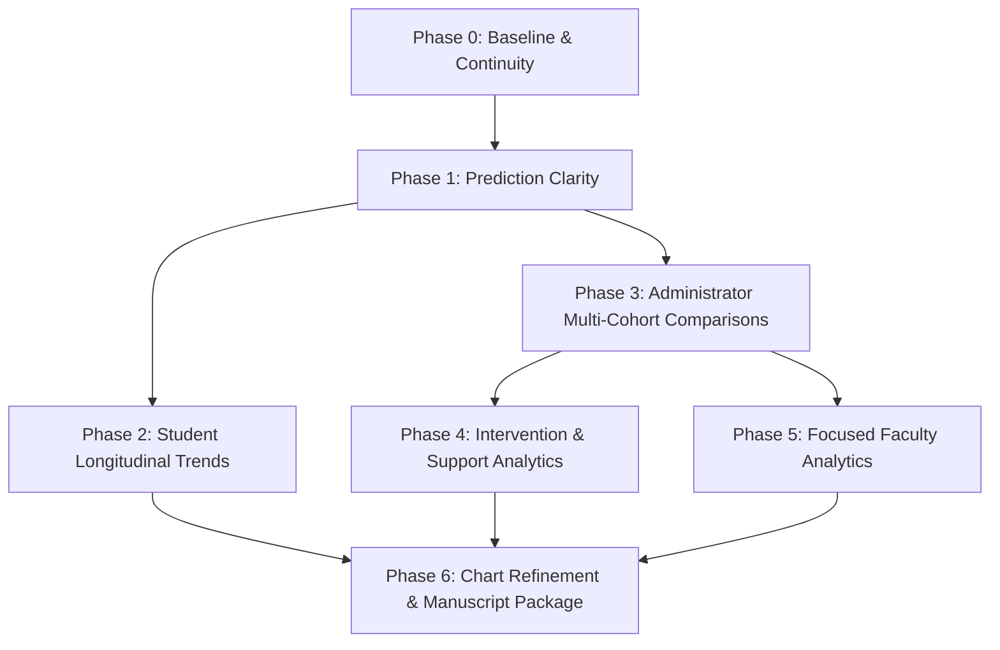

# Post-Defense Analytics Roadmap — UDM-RADAR

**Document Version:** 1.0.0
**Accepted Baseline SHA:** `a79fb4838c5e2bc163cf943cda20afba9946d26b`
**Status Taxonomy:** `NOT STARTED` | `IN PROGRESS` | `BLOCKED` | `MVP COMPLETE` | `VERIFIED` | `MERGED` | `DEFERRED`
**Ownership Notice:** Sol owns active post-defense implementation; Antigravity maintains knowledge frameworks and continuity baselines.

---

## 1. Roadmap Architecture Overview

---

## 2. Phase-by-Phase Specifications

### Phase 0: Baseline and Continuity
- **Goal:** Establish a permanent, self-contained knowledge package, verified starter onboarding seed, and execution boundaries so future contributors require zero chat history.
- **Dependencies:** Accepted `origin/main` at `a79fb4838c5e2bc163cf943cda20afba9946d26b`.
- **MVP Deliverables:**
  - Complete post-defense Markdown knowledge base (`docs/post-defense/`).
  - Formal decision log and terminology reference.
  - Verification matrix and work package templates.
  - Supplemental offline continuity ZIP pack.
- **Deferred Refinement:** Automated documentation sync bots (unnecessary overhead for prototype).
- **Verification Tests:** Documentation cross-link inspection, Markdown linter, clean ZIP integrity check.
- **Exit Criteria:** Continuity package reviewed, merged to `main`, and accessible to all team members.
- **Current Status:** `IN PROGRESS` (Antigravity delivery)

---

### Phase 1: Prediction Clarity & Uncertainty Modeling
- **Goal:** Address panel feedback regarding continuous GWA output transparency, model error margins, and non-deterministic presentation.
- **Dependencies:** Phase 0 baseline; active `python_ml/model.pkl` and `python_ml/model_metrics.json`.
- **MVP Deliverables:**
  - Clear label in Student and Admin portals stating: *"The Decision Tree Regressor predicts estimated continuous GWA on the 4.00–1.00 point scale. Advisory risk triage is derived from this point estimate."*
  - Empirical error band display using test MAE ($\pm 0.15$ points), clamping the range to $[1.00, 4.00]$.
  - Transparent distinction between model evaluation metrics (MAE, RMSE, $R^2$) and derived risk triage.
- **Deferred Refinement:** Dynamic heteroscedastic prediction intervals based on student feature distance.
- **Verification Tests:** PHP unit test asserting range clamping $[1.00, 4.00]$; browser checks verifying clear uncertainty wording.
- **Exit Criteria:** Student and Admin prediction cards display continuous point prediction with defensible error bounds.
- **Current Status:** `NOT STARTED` (Assigned to Sol)

---

### Phase 2: Student Longitudinal Trends & Progression
- **Goal:** Provide students with intuitive progression context comparing current estimated or completed GWA against their previous completed academic term.
- **Dependencies:** Phase 1; shared `includes/grade_history.php` helper.
- **MVP Deliverables:**
  - Term-over-term point delta metric ($\Delta\text{GWA} = \text{Current/Projected GWA} - \text{Previous Completed GWA}$).
  - Accessible visual indicator (positive point delta = upward trend / academic progress; negative = lower achievement).
  - Secondary relative change percentage tooltip.
  - Longitudinal historical GWA trend line (Chart.js) across completed terms with explicit point labels.
- **Deferred Refinement:** Logarithmic velocity models; predictive trajectory forecasting beyond current term.
- **Verification Tests:** Unit tests for point delta calculation across irregular/summer term boundaries; Playwright gauge contrast tests.
- **Exit Criteria:** Student dashboard displays historical trend chart and verified term-over-term progression delta.
- **Current Status:** `NOT STARTED` (Assigned to Sol)

---

### Phase 3: Administrator Multi-Cohort Comparisons
- **Goal:** Equip administrators with multi-dimensional cohort slicing across school years, semesters, curriculum year levels, sections, and subjects.
- **Dependencies:** Phase 1; verified synthetic multi-year cohort datasets (`tools/seed_multiyear_cohorts.php`).
- **MVP Deliverables:**
  - Interactive multi-select or dropdown filter bar in Admin portal:
    - School Year (`2024-2025`, `2025-2026`, `2026-2027`)
    - Semester (`1st`, `2nd`, `Summer`)
    - Year Level (`1st Year` through `4th Year`)
    - Section (`IT-31` through `IT-38`, `IT-11`, etc.)
    - Course Track (`Software Development`, `Data Science`, `Cyber Security`)
  - Cohort GWA distribution histogram and risk migration summary.
  - Subject-level average grade and pass-rate comparative table.
- **Deferred Refinement:** Multi-dimensional OLAP cubes or dynamic SQL pivot builders.
- **Verification Tests:** SQL injection prevention tests on query filters; integration checks verifying exclusion of non-numeric marks from denominators.
- **Exit Criteria:** Admin analytics page renders filtered cohort distributions with zero runtime errors.
- **Current Status:** `NOT STARTED` (Assigned to Sol)

---

### Phase 4: Intervention & Support Case Analytics
- **Goal:** Provide visibility into the lifecycle, responsiveness, and outcomes of academic support interventions.
- **Dependencies:** Phase 3; `academic_support_cases` and `support_case_referrals` tables.
- **MVP Deliverables:**
  - Administrative Support Metrics: Total cases opened, active notices awaiting student review, acknowledged notices.
  - Faculty responsiveness: Average elapsed time from case trigger to notice issuance (`notice_issued_at - created_at`).
  - Student responsiveness: Average elapsed time from notice issuance to student acknowledgment (`student_acknowledged_at - notice_issued_at`).
  - Reason code breakdown chart (distribution of the 6 canonical reason codes).
- **Deferred Refinement:** Automated follow-up escalations or email dispatch integration.
- **Verification Tests:** SQL calculation unit tests for datetime differences handling NULL values gracefully; audit log integrity.
- **Exit Criteria:** Admin Support Overview displays verified lifecycle counts and latency metrics.
- **Current Status:** `NOT STARTED` (Assigned to Sol)

---

### Phase 5: Focused Faculty Analytics
- **Goal:** Surface class-level grade dispersion and support workload metrics to faculty for their assigned teaching loads.
- **Dependencies:** Phase 4; `faculty_class_loads` ownership contracts.
- **MVP Deliverables:**
  - Section grade distribution curve per assigned subject.
  - Roster risk triage breakdown (count of High, Moderate, Low risk students enrolled in the class).
  - Subject-level pacing indicator comparing current preliminary class average against historical subject benchmark.
  - Strict absence of cross-faculty performance rankings (load and support context only).
- **Deferred Refinement:** Real-time quiz-level item analysis or automated attendance correlation.
- **Verification Tests:** Ownership authorization tests ensuring faculty cannot inspect unassigned sections; Playwright visual tests.
- **Exit Criteria:** Faculty class load cards display section grade distributions without cross-faculty comparisons.
- **Current Status:** `NOT STARTED` (Assigned to Sol)

---

### Phase 6: Chart Refinement & Manuscript Figure Package
- **Goal:** Ensure all analytical charts adhere to WCAG 2.1 AA accessibility standards and generate publication-quality figures for the capstone manuscript.
- **Dependencies:** Phases 1 through 5.
- **MVP Deliverables:**
  - Accessible Chart.js color palette with distinctive patterns/borders for colorblind accessibility.
  - Standardized axis titles, legends, and data table fallbacks for every chart canvas.
  - One-click SVG/PNG export button for manuscript documentation.
  - Consolidated post-defense results chapter update.
- **Deferred Refinement:** Interactive 3D surface charts or custom WebGL canvas renderers.
- **Verification Tests:** Automated Lighthouse / Axe accessibility audits; visual regression checks.
- **Exit Criteria:** All charts pass WCAG contrast checks and manuscript figures match accepted software state.
- **Current Status:** `NOT STARTED` (Assigned to Sol / Proponents)
