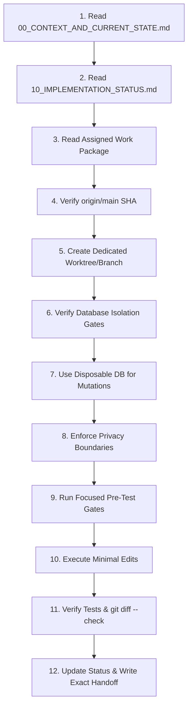

# Autonomous Agent Continuation Protocol — UDM-RADAR

**Document Version:** 1.0.0 (Mandatory Protocol)
**Applicability:** All autonomous AI coding agents (Antigravity, Codex, Copilot, etc.) operating in this repository.
**Governing Rule:** Follow this exact protocol before taking any automated coding action.

---

## 1. Mandatory Pre-Execution Sequence

Before generating code, modifying files, or issuing shell commands, you must execute this 12-step sequence:

1. **Read Context First:** Inspect `docs/post-defense/00_CONTEXT_AND_CURRENT_STATE.md` to understand current architecture.
2. **Read Status Ledger:** Check `docs/post-defense/10_IMPLEMENTATION_STATUS.md` to discover what is already completed, in progress, or blocked.
3. **Read Specific Package:** Review the relevant work package in `docs/post-defense/` before implementing.
4. **Verify Latest Origin Main:** Run `git fetch origin` and record the current `origin/main` SHA.
5. **Work in an Isolated Worktree:** Never edit files on `main` or in `C:\xampp\htdocs\capstone` directly.
6. **Verify Database Isolation:** Confirm that no script or test targets `udm_radar`.
7. **Use Disposable Databases:** All automated mutation tests, migrations, and synthetic seed scripts must target `udm_radar_scratch` or a temporary database (`udm_radar_val_temp`).
8. **Preserve Privacy & Ethics:** Ensure all generated data uses synthetic namespaces (`@synthetic.udm.edu.ph`). Never output genuine personal data.
9. **Run Focused Tests:** Verify existing passing baseline tests before introducing new modifications.
10. **Stage Minimal Diffs:** Stage only the explicit files belonging to the work package. Run `git diff --check`.
11. **Update Decision Logs:** Document any architectural rationale in `docs/post-defense/decisions/DECISION_LOG.md`.
12. **Leave an Exact Handoff:** Use `AGENT_HANDOFF_TEMPLATE.md` to provide exact SHA, test results, and next actions.

---

## 2. DO NOT ASSUME (Common AI Hallucination Traps)

> [!CAUTION]
> Future agents frequently make false assumptions in this repository. Review this list before reasoning about the codebase:

1. **DO NOT ASSUME the Decision Tree outputs risk.**
   The Decision Tree Regressor outputs a **continuous numerical GWA** ($4.00\text{--}1.00$). Risk classification (`HIGH`, `MODERATE`, `LOW`) is a downstream rule-based threshold applied in PHP, NOT a model classification output.
2. **DO NOT ASSUME $R^2$ is an accuracy percentage.**
   $R^2$ is the regression coefficient of determination ($-\infty \le R^2 \le 1.0$), measuring variance explained. It must never be described as "92% model accuracy".
3. **DO NOT ASSUME higher GWA numbers are worse.**
   UDM uses the standard Philippine discrete point scale where **$4.00$ is the highest/excellent grade** and **$1.00$ is passing**. $4.00 > 3.00 > 2.00 > 1.00$. A positive change ($+0.25$) is an improvement.
4. **DO NOT ASSUME Faculty comparisons measure teaching quality.**
   Section grade variations reflect student cohort pacing, irregular student load, and curriculum difficulty. You must never rank faculty or create "best/worst professor" lists. The mandatory non-evaluative disclaimer is legally required.
5. **DO NOT ASSUME a Git pull updates MariaDB automatically.**
   Git operates strictly on the filesystem. Database schema changes require explicit execution of approved SQL migrations.
6. **DO NOT ASSUME Migration 011 is approved.**
   Migration 011 was an unmerged prototype and is strictly excluded. The current canonical migration sequence ends at `010`.
7. **DO NOT ASSUME the Python Flask ML service is always running.**
   The application is intentionally resilient. If Flask on port 5000 is offline, PHP automatically invokes deterministic calculation fallbacks without fatal crashes.
8. **DO NOT ASSUME the private PEF/CC template is tracked in Git.**
   The official registrar spreadsheet template contains proprietary formulas and registrar evaluations; it lives outside Git. The codebase uses private COM automation with SHA-256 verification.
9. **DO NOT ASSUME students agree with academic notices.**
   Student acknowledgment of support notices records **receipt only** (`student_acknowledged_at`), never admission of fault or agreement.
10. **DO NOT ASSUME missing grades are zero or failure.**
    Missing preliminary or final grades must be rendered as `NULL`, `—`, or `In Progress`. Never coerce missing data to `0.00` or treat it as failure.
